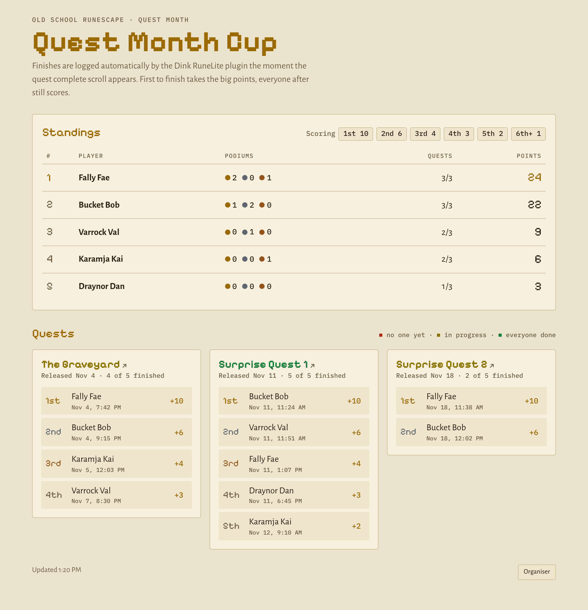

# OSRS Quest Month Cup

A self-hosted scoreboard for a friendly race through Old School RuneScape's Quest Month (November 2026). Each player runs the [Dink](https://github.com/pajlads/DinkPlugin) RuneLite plugin. The moment the quest complete scroll appears, Dink posts the completion to this server, and the scoreboard updates for everyone. Nobody types anything in, and the order of finishes comes from when the server received each one.

<picture>
  <source media="(prefers-color-scheme: dark)" srcset="docs/screenshot-dark.png">
  
</picture>

<sub>Example data. The real surprise quests are named on release day.</sub>

- One small Docker container: Node 26 LTS, no dependencies, SQLite on a volume.
- Published to the internet through a Cloudflare Tunnel, so no ports are opened on your router.
- Viewing is public and read-only. Only the organiser, who has a key, can add players and quests.

## Scoring

Each quest is scored on its own, by finish order:

| Place  | 1st | 2nd | 3rd | 4th | 5th | 6th and later |
|--------|-----|-----|-----|-----|-----|---------------|
| Points | 10  | 6   | 4   | 3   | 2   | 1             |

Players are ranked by total points. Ties go to whoever has more first places, then more second places, and so on. To change the curve, edit `POINTS` near the top of the script in `public/index.html`.

Only quests the organiser adds to the cup count, and only finishes after `CUP_START`. Completions on seasonal worlds (Leagues, Deadman) are ignored. If Dink sends the same finish twice, only the first one counts.

## How it works

```
RuneLite + Dink  ──POST /hook/<WEBHOOK_TOKEN>──▶  cup container  ◀──  cloudflared  ◀──  https://cup.example.com
(each player)       (and Discord, if you like)    (SQLite in /data)
```

- `POST /hook/<WEBHOOK_TOKEN>` receives Dink notifications. Only `QUEST` notifications are stored, and only the player name and quest name are kept. Screenshots are discarded.
- `GET /` serves the scoreboard page. `GET /api/state` returns the roster, cup quests and finishes as JSON.
- Organiser actions (add or remove players and quests, log a finish by hand) need the `ADMIN_TOKEN`. Enter it under **Organiser** at the bottom of the page.

Every Dink quest completion is stored, even for players or quests that aren't in the cup yet. Adding a player or quest later picks up their earlier finishes automatically, and the organiser tools list quest names and RSNs that have reported in but aren't on the lists yet. That makes adding each surprise quest on release day a single click.

## Setup

### 1. Generate secrets

You need two long random strings. Keep them private and never commit them.

```sh
openssl rand -hex 24   # WEBHOOK_TOKEN — goes in each player's Dink settings
openssl rand -hex 24   # ADMIN_TOKEN   — only the organiser needs this
```

### 2. Create a Cloudflare Tunnel

You need a domain on Cloudflare (the free plan works).

1. In the Cloudflare dashboard, go to **Zero Trust → Networks → Tunnels → Create a tunnel**. Choose **Cloudflared**, then name it, for example `quest-cup`.
2. On the install screen, choose **Docker** and copy the token, which is the long string after `--token`. That is your `TUNNEL_TOKEN`. You don't need to run the command it shows.
3. Add a **Public hostname**:
   - Subdomain and domain: for example `cup.example.com`
   - Service type: `HTTP`
   - URL: `cup:8080` if cloudflared runs in the same compose project as below. If you run cloudflared separately (for example the TrueNAS cloudflared app), use `<nas-lan-ip>:8080` and publish port 8080 on the cup container.

### 3a. Run with Docker Compose (any Linux host)

```sh
git clone https://github.com/pans-library/osrs-quest-month-cup.git
cd osrs-quest-month-cup
cp .env.example .env      # then fill in the values
mkdir -p data && sudo chown 1000:1000 data
docker compose up -d
docker compose logs -f cup
```

`compose.yaml` runs two containers: the cup server, and cloudflared using your `TUNNEL_TOKEN`. The image is built by GitHub Actions and pulled from `ghcr.io/pans-library/osrs-quest-month-cup`. To build it yourself, replace `image:` with `build: .`.

### 3b. Run on TrueNAS SCALE (Apps → Discover Apps → Custom App → Install via YAML)

Paste the YAML below, with your own values filled in. This copy lives only on your NAS, so the secrets never touch the repository.

The database goes in a named Docker volume, `cup-data`, which TrueNAS keeps with the app. You don't need to create a dataset or set permissions: on first start, Docker gives the new volume the same owner as `/data` in the image, which is the container's own user.

```yaml
services:
  cup:
    image: ghcr.io/pans-library/osrs-quest-month-cup:latest
    restart: unless-stopped
    environment:
      WEBHOOK_TOKEN: "<your webhook token>"
      ADMIN_TOKEN: "<your admin token>"
      CUP_START: "2026-11-01T00:00:00Z"
    volumes:
      - cup-data:/data
    deploy:
      resources:
        limits:
          cpus: "1.0"
          memory: 384M
          pids: 100
    read_only: true
    tmpfs: [/tmp]
    cap_drop: [ALL]
    security_opt: ["no-new-privileges:true"]
  cloudflared:
    image: cloudflare/cloudflared:2026.10.4
    restart: unless-stopped
    command: tunnel --no-autoupdate run
    deploy:
      resources:
        limits:
          cpus: "0.5"
          memory: 128M
    environment:
      TUNNEL_TOKEN: "<your tunnel token>"
    depends_on:
      - cup

volumes:
  cup-data:
```

If you already run the TrueNAS **cloudflared** app, leave out the `cloudflared` service. Instead, publish a port on `cup`, for example `ports: ["30080:8080"]`, and point the tunnel's public hostname at `http://<nas-lan-ip>:30080`. Any free host port works; TrueNAS apps conventionally use 30000 and up.

The `deploy.resources.limits` block keeps the cup from taking more than one CPU core and 384 MB of memory. It idles at about 50 MB. The server also limits how much upload data it holds at once (`MAX_INFLIGHT_MB`), refusing extra uploads with "busy" rather than growing past the limit. The other settings run it with a read-only filesystem and no extra privileges.

Deleting the app can also delete its volume, and the cup's history with it. Back up the database first if you want to keep it (see Operating notes).

### 4. Check it

- `https://cup.example.com/` shows the scoreboard.
- `https://cup.example.com/healthz` returns `{"ok":true}`.
- Click **Organiser** at the bottom of the page, enter your `ADMIN_TOKEN`, and add players by RSN. Quests from the seed file (see below) are already there.
- The organiser tools include a ready-to-paste **message for your friends** and, separately, the exact **Dink webhook link** with a copy button. Post the message in your group chat; send the link to each player privately.

To check the webhook before any quest releases, send a fake completion and confirm it appears in the organiser's "Quests seen" list. Set `CUP_START` to a past date while you test:

```sh
curl -X POST https://cup.example.com/hook/<WEBHOOK_TOKEN> \
  -H 'content-type: application/json' \
  -d '{"type":"QUEST","playerName":"Your RSN","extra":{"questName":"Test Quest"}}'
```

## Preloaded quests

`seed/quests.json` lists quests to load on launch, so a fresh install starts with the cup's quests already on the board:

```json
{
  "quests": [
    { "name": "The Graveyard", "wikiUrl": "https://oldschool.runescape.wiki/w/The_Graveyard" },
    { "name": "Another Quest", "releaseDate": "2026-11-12" }
  ]
}
```

- `name` must match the in-game quest name, since that's what Dink reports.
- `wikiUrl` and `releaseDate` (`YYYY-MM-DD`) are optional. Without `wikiUrl`, the quest links to the wiki page named after it.
- Each quest is added once. If the organiser removes a seeded quest, it stays removed after restarts. Quests added to the file in a later image appear on the next restart.

The image ships with this repository's seed file. To use your own, mount a file and point `SEED_FILE` at it, for example `-v ./my-quests.json:/seed.json:ro -e SEED_FILE=/seed.json`.

The organiser can also change any quest's release date and wiki link from its card. Wiki links must point to `https://oldschool.runescape.wiki/`.

## Player setup (Dink)

Each player does this once in RuneLite:

1. Open the **Plugin Hub**, search for **Dink**, and install it.
2. In Dink's settings, under **Primary Webhook URLs**, put each URL on its own line:
   ```
   https://discord.com/api/webhooks/...        (your group's Discord webhook, optional)
   https://cup.example.com/hook/<WEBHOOK_TOKEN>
   ```
   If you set an override URL in Dink's **Quest** section, Dink ignores the primary URLs for quests. In that case, add the cup URL to the override as well.
3. Under **Quest**, turn on **Enable Quests**.

Your RSN on the cup roster must match your in-game name. Capitals, spaces and underscores don't matter.

## Operating notes

- **Keep the webhook URL private.** Anyone who has it can post fake completions. Only RSNs on the roster count, but if the URL leaks, change `WEBHOOK_TOKEN` and send the new URL to your players. Send it by direct message, not in a public Discord channel.
- **Keep the organiser key private.** If it leaks, change `ADMIN_TOKEN` and restart the container; the old key stops working immediately. The page remembers the key in the browser until you click **Lock organiser tools**, so lock it on shared computers.
- **What's public.** Anyone with the scoreboard address can see the roster RSNs and finish times, including through `/api/state`. The webhook link and organiser key are never shown to visitors.
- **Updating.** New images include security fixes. With Docker Compose, run `docker compose pull && docker compose up -d`. On TrueNAS, use the app's **Update** button, or redeploy to pull the latest image.
- **If the server goes down**, completions sent during that time are lost. Dink doesn't resend them. Keep Discord as a second webhook so there's a record, and use **Log a finish by hand** in the organiser tools to backfill each one with its time.
- **Backups**: the whole database is `cup.sqlite` in `/data`. Stop the container first so everything has been written to that file, then copy it out:
  - Docker Compose with the bind mount: copy `data/cup.sqlite`.
  - Named volume (TrueNAS): stop the app, then in the TrueNAS shell find the container with `docker ps -a | grep cup` and run `docker cp <container>:/data/cup.sqlite ./cup.sqlite`.
- **Cloudflare Access** works if you want the scoreboard private. Add a **Bypass** policy for the path `/hook/*`, because Dink can't sign in.

## Updates

Dependabot checks weekly for new versions of the Node base image, the pinned `cloudflared` image and the GitHub Actions used to build. If you run from the TrueNAS YAML above, bump the `cloudflared` tag there when the repository's tag changes. Cloudflare supports each `cloudflared` release for about a year.

## Security

See [SECURITY.md](SECURITY.md) to report a vulnerability privately.

## Configuration

| Variable        | Required | Default                 | Purpose |
|-----------------|----------|-------------------------|---------|
| `WEBHOOK_TOKEN` | yes      |                         | Secret path segment for Dink, at least 16 characters |
| `ADMIN_TOKEN`   | yes      |                         | Organiser key, at least 16 characters |
| `CUP_START`     | no       | `2026-11-01T00:00:00Z`  | Ignore completions before this time |
| `PORT`          | no       | `8080`                  | Listen port inside the container |
| `DATA_DIR`      | no       | `/data`                 | Where `cup.sqlite` lives |
| `SEED_FILE`     | no       | `seed/quests.json` in the image | Quests to preload, see Preloaded quests |
| `MAX_INFLIGHT_MB` | no     | `48`                    | Upload data held in memory at once; extra uploads get "busy" (HTTP 503) |
| `MAX_EVENTS`    | no       | `20000`                 | Stop storing webhook posts after this many, to protect the disk if the webhook link leaks |
| `TUNNEL_TOKEN`  | compose  |                         | Cloudflare Tunnel token for the bundled cloudflared |

## Local development

```sh
WEBHOOK_TOKEN=devhook0123456789 ADMIN_TOKEN=devadmin0123456789 CUP_START=2020-01-01T00:00:00Z DATA_DIR=./data node server.js
```

Use Node 26 to match the container. `.node-version` pins it for fnm, mise, nodenv and asdf; with nvm, run `nvm use $(cat .node-version)`. Node 22.13 or newer also works, since that is the first release with `node:sqlite` available without a flag.

---

Not affiliated with Jagex, RuneLite or the Dink project. Old School RuneScape is a trademark of Jagex Ltd.

The trophy icon is [Trophy cup](https://game-icons.net/1x1/delapouite/trophy-cup.html) by Delapouite from [game-icons.net](https://game-icons.net), used under [CC BY 3.0](https://creativecommons.org/licenses/by/3.0/) and recoloured.
